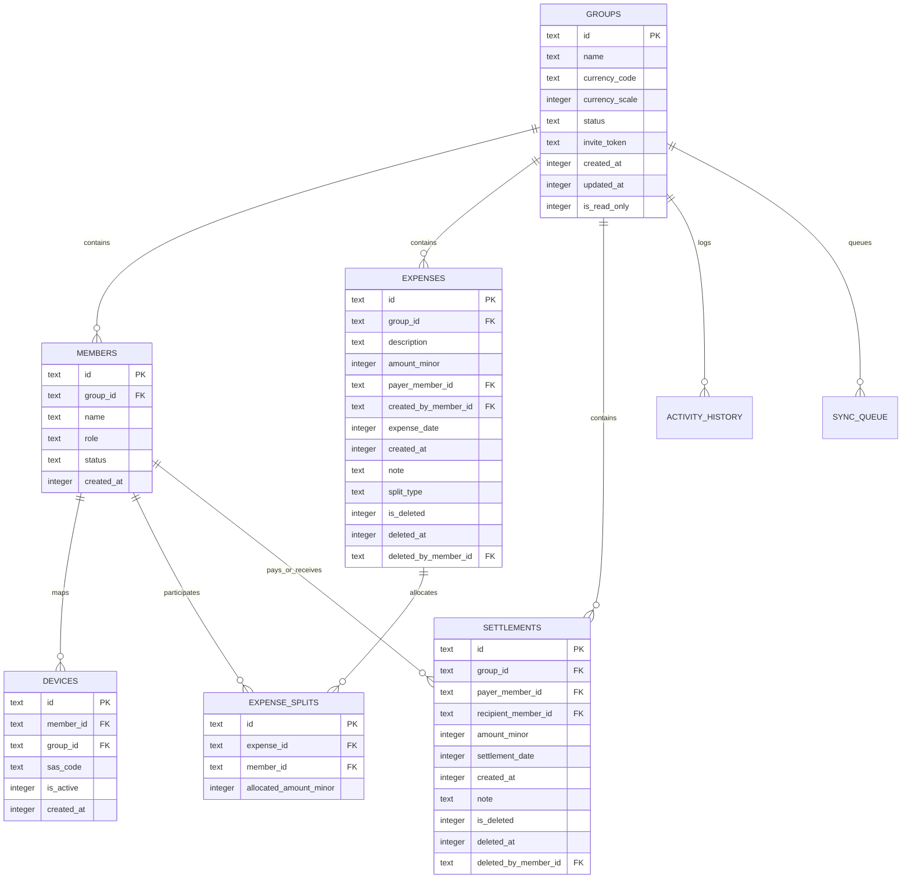
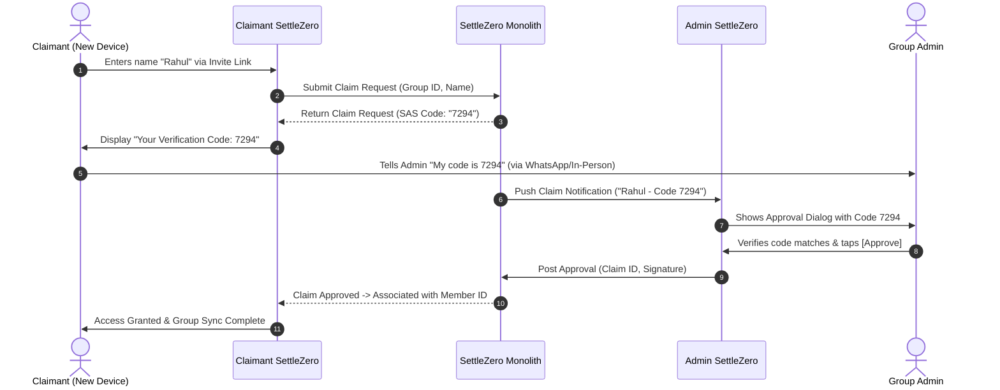

# SettleZero — Technical Architecture Specification v0.1

**Product:** SettleZero  
**Tagline:** *Split bills, settle to zero. Keep the app free.*  
**Target Platform:** Android (Native, Kotlin)  
**Backend:** Lightweight Monolithic REST API  
**Status:** Approved for Implementation  

---

## 1. Architectural Philosophy & Invariants

SettleZero is an accountless, local-first, distributed expense ledger designed to operate with zero friction, zero subscriptions, and complete offline autonomy.

```mermaid
graph TD
    subgraph Android Device [Android Client Local-First]
        UI[Jetpack Compose UI - MVI / UDF]
        VM[ViewModels + StateFlow]
        Engine[Deterministic Calculation Engine]
        Repo[Repository Layer]
        Room[(Room Database - SQLite)]
        WM[Jetpack WorkManager SyncQueue]
    end

    subgraph Backend Infrastructure [Boring Monolith]
        API[Lightweight REST API]
        Auth[Anonymous Device Auth]
        DB[(PostgreSQL / SQLite)]
        FCM[Firebase Cloud Messaging Push]
    end

    UI --> VM
    VM --> Engine
    VM --> Repo
    Repo --> Room
    Repo --> WM
    WM -->|Idempotent JSON Ops| API
    API --> Auth
    API --> DB
    API -.->|Silent Wakeup Push| FCM
    FCM -.->|Push Delivery| Android Device
```

### Core Invariants
1. **Local-First & Offline-First:** Every read query targets the local SQLite database. The UI is 100% functional without network connectivity.
2. **Deterministic Append-Only Financial Ledger:** Balances, debts, and simplifications are *derived projections* calculated from immutable `Expenses` and `Settlements`. Balances are never stored as authoritative columns.
3. **Integer Minor-Unit Currency (`Long`):** All financial amounts are stored as 64-bit signed integers representing the currency's smallest minor unit (e.g., paise, cents, fils). Floating-point arithmetic (`Float`, `Double`) is strictly forbidden.
4. **Accountless Device Identity:** Users do not log in. A device creates an asymmetric keypair or random `Device ID` stored in Android Keystore.
5. **No Silent Data Loss:** Conflicting offline modifications or permission rejections are surfaced explicitly to the user and remain exportable.

---

## 2. Android Client Architecture

The Android app follows modern Android development standards using Clean Architecture and Unidirectional Data Flow (UDF) with MVI state modeling.

```text
app/
├── core/
│   ├── common/         # Result monad, DispatcherProvider, TimeProvider
│   ├── model/          # Pure immutable Kotlin domain models & Enums
│   ├── database/       # Room DB, Entities, DAOs, TypeConverters, Migrations
│   ├── network/        # Ktor/Retrofit client, DTOs, Auth interceptors
│   ├── domain/         # Calculation engine, Simplification, Currency lookup
│   └── sync/           # SyncManager, WorkManager SyncWorker, Operation Queue
├── feature/
│   ├── group/          # Group dashboard, balance summary, member list
│   ├── expense/        # Add/Edit expense, participant selectors, unequal splits
│   ├── settlement/     # Settle Up flow, payment recording, confirmations
│   ├── claim/          # Invite preview, join flow, SAS verification PIN UI
│   ├── history/        # Chronological audit feed & filtering
│   └── sync_issues/    # Conflict resolution & rejected sync inspection
└── app/                # Application class, DI (Hilt), NavHost
```

### Technology Stack
* **Language:** Kotlin 2.x
* **UI Toolkit:** Jetpack Compose with Material 3 (Dynamic Color, Dark Mode, Edge-to-Edge)
* **Concurrency:** Kotlin Coroutines + `StateFlow` / `SharedFlow`
* **Local Persistence:** Android Jetpack Room (SQLite)
* **Background Scheduling:** Android Jetpack WorkManager
* **Dependency Injection:** Hilt
* **Serialization:** Kotlinx Serialization (JSON)
* **Networking:** Ktor HTTP Client / Retrofit + OkHttp
* **Security:** Android Keystore + EncryptedSharedPreferences

---

## 3. Database Schema & Relational Model (Room)



### Detailed Table Definitions

#### `groups`
| Column | Type | Constraints | Description |
|---|---|---|---|
| `id` | `TEXT` | `PRIMARY KEY` | Immutable UUIDv4 string |
| `name` | `TEXT` | `NOT NULL` | Displayed name (supports emoji, max 64 chars) |
| `currency_code` | `TEXT` | `NOT NULL` | ISO-4217 code (e.g. `INR`, `USD`, `JPY`) |
| `currency_scale` | `INTEGER` | `NOT NULL` | Decimals exponent (e.g. `2` for INR/USD, `0` for JPY) |
| `status` | `TEXT` | `NOT NULL` | `'ACTIVE'` or `'ARCHIVED'` |
| `invite_token` | `TEXT` | `NOT NULL UNIQUE` | Cryptographically random base64url string |
| `is_currency_locked` | `INTEGER` | `NOT NULL DEFAULT 0` | Set to `1` when first transaction is created |
| `is_read_only` | `INTEGER` | `NOT NULL DEFAULT 0` | Set to `1` for imported JSON snapshots |
| `created_at` | `INTEGER` | `NOT NULL` | Epoch timestamp in milliseconds |
| `updated_at` | `INTEGER` | `NOT NULL` | Epoch timestamp in milliseconds |

#### `members`
| Column | Type | Constraints | Description |
|---|---|---|---|
| `id` | `TEXT` | `PRIMARY KEY` | Immutable UUIDv4 string |
| `group_id` | `TEXT` | `NOT NULL, REFERENCES groups(id) ON DELETE CASCADE` | Parent group |
| `name` | `TEXT` | `NOT NULL` | Group-unique display name (case-insensitive unique index) |
| `role` | `TEXT` | `NOT NULL` | `'SUPER_ADMIN'`, `'ADMIN'`, `'MEMBER'` |
| `status` | `TEXT` | `NOT NULL` | `'ACTIVE_CLAIMED'`, `'ACTIVE_UNCLAIMED'`, `'ARCHIVED'` |
| `created_at` | `INTEGER` | `NOT NULL` | Epoch timestamp in milliseconds |

#### `expenses`
| Column | Type | Constraints | Description |
|---|---|---|---|
| `id` | `TEXT` | `PRIMARY KEY` | Immutable UUIDv4 string |
| `group_id` | `TEXT` | `NOT NULL, REFERENCES groups(id) ON DELETE CASCADE` | Parent group |
| `description` | `TEXT` | `NOT NULL` | Single-line description (plain text + emoji) |
| `amount_minor` | `INTEGER` | `NOT NULL, CHECK (amount_minor > 0)` | Minor units (`Long`) |
| `payer_member_id` | `TEXT` | `NOT NULL, REFERENCES members(id)` | Member who fronted payment |
| `created_by_member_id`| `TEXT` | `NOT NULL, REFERENCES members(id)` | Member who entered the record |
| `expense_date` | `INTEGER` | `NOT NULL` | User-selected date (midnight epoch ms) |
| `created_at` | `INTEGER` | `NOT NULL` | Immutable device creation timestamp |
| `note` | `TEXT` | `NULL` | Multiline optional note |
| `split_type` | `TEXT` | `NOT NULL` | `'EQUAL'` or `'UNEQUAL'` |
| `is_deleted` | `INTEGER` | `NOT NULL DEFAULT 0` | Soft-delete flag |
| `deleted_at` | `INTEGER` | `NULL` | Deletion timestamp |
| `deleted_by_member_id`| `TEXT` | `NULL, REFERENCES members(id)` | Admin or creator who soft-deleted |

#### `settlements`
| Column | Type | Constraints | Description |
|---|---|---|---|
| `id` | `TEXT` | `PRIMARY KEY` | Immutable UUIDv4 string |
| `group_id` | `TEXT` | `NOT NULL, REFERENCES groups(id) ON DELETE CASCADE` | Parent group |
| `payer_member_id` | `TEXT` | `NOT NULL, REFERENCES members(id)` | Payer settling debt |
| `recipient_member_id`| `TEXT` | `NOT NULL, REFERENCES members(id)` | Recipient receiving payment |
| `amount_minor` | `INTEGER` | `NOT NULL, CHECK (amount_minor > 0)` | Minor units (`Long`) |
| `settlement_date` | `INTEGER` | `NOT NULL` | User-selected date |
| `created_at` | `INTEGER` | `NOT NULL` | Immutable creation timestamp |
| `note` | `TEXT` | `NULL` | Optional note |
| `is_deleted` | `INTEGER` | `NOT NULL DEFAULT 0` | Soft-delete flag (settlements cannot be edited) |
| `deleted_at` | `INTEGER` | `NULL` | Deletion timestamp |
| `deleted_by_member_id`| `TEXT` | `NULL, REFERENCES members(id)` | Admin or creator who deleted |

#### `sync_queue`
| Column | Type | Constraints | Description |
|---|---|---|---|
| `id` | `TEXT` | `PRIMARY KEY` | Operation UUID |
| `group_id` | `TEXT` | `NOT NULL, REFERENCES groups(id) ON DELETE CASCADE` | Target group |
| `operation_type` | `TEXT` | `NOT NULL` | E.g. `'ADD_EXPENSE'`, `'DELETE_SETTLEMENT'` |
| `payload_json` | `TEXT` | `NOT NULL` | JSON serialized operation payload |
| `idempotency_key` | `TEXT` | `NOT NULL UNIQUE` | Prevents duplicate server execution |
| `status` | `TEXT` | `NOT NULL` | `'PENDING'`, `'IN_FLIGHT'`, `'REJECTED'` |
| `error_message` | `TEXT` | `NULL` | Explains why server rejected operation |
| `attempt_count` | `INTEGER` | `NOT NULL DEFAULT 0` | Retry counter |
| `created_at` | `INTEGER` | `NOT NULL` | Enqueue timestamp |

---

## 4. Deterministic Financial & Calculation Engine

### 4.1 Minor-Unit Scaling & Formatting
All arithmetic uses integer primitives. For a currency with scale $S$ (e.g., INR where $S=2$):
$$\text{amount\_minor} = \text{round}(\text{amount\_user} \times 10^S)$$

Floating point types are never used in calculation. Output formatting utilizes `BigDecimal` purely for display string generation:
```kotlin
fun formatCurrency(amountMinor: Long, scale: Int, currencyCode: String): String {
    val factor = BigDecimal.TEN.pow(scale)
    val displayValue = BigDecimal(amountMinor).divide(factor, scale, RoundingMode.UNNECESSARY)
    return "${Currency.getInstance(currencyCode).symbol} $displayValue"
}
```

### 4.2 Deterministic Equal Split Remainder Allocation
When dividing $A$ (total minor units) among $N$ participants:
$$\text{base} = \lfloor A / N \rfloor, \quad R = A \pmod N$$
The remainder $R$ minor units are distributed to the first $R$ participants when sorted **lexicographically by immutable `Member ID`**:

```kotlin
fun allocateEqualSplit(amountMinor: Long, participantIds: List<String>): Map<String, Long> {
    require(participantIds.isNotEmpty())
    val sorted = participantIds.sorted() // Lexicographical sort on Member UUID
    val n = sorted.size
    val base = amountMinor / n
    val remainder = (amountMinor % n).toInt()

    return sorted.mapIndexed { index, id ->
        id to (base + if (index < remainder) 1L else 0L)
    }.toMap()
}
```
*Guarantee:* Every client calculates the exact same split down to the exact 1 paisa / 1 cent regardless of system locale or device platform.

### 4.3 Net Balance Derivation
Net balance for member $M$ is derived from all active (non-deleted) transactions:
$$\text{Net}(M) = \sum \text{PaidAsExpense}(M) - \sum \text{ShareAsParticipant}(M) + \sum \text{ReceivedSettlement}(M) - \sum \text{PaidSettlement}(M)$$

$$\text{Invariant across group: } \sum_{M \in \text{Members}} \text{Net}(M) = 0$$

### 4.4 Debt Simplification Algorithm with Lexicographical Tie-Breaking
The goal is to calculate a minimum number of transfers that clears all net debts. Because subset-sum is NP-hard and multiple minimal graphs can exist, SettleZero employs a **deterministic greedy algorithm**:

```kotlin
data class DebtTransfer(val fromMemberId: String, val toMemberId: String, val amountMinor: Long)

fun simplifyDebts(netBalances: Map<String, Long>): List<DebtTransfer> {
    // 1. Separate debtors (net < 0) and creditors (net > 0)
    // 2. Sort strictly: Debtors ascending by balance; Creditors descending by balance.
    // 3. TIE-BREAKER: Sort lexicographically by Member ID string to guarantee determinism.
    val debtors = netBalances.filter { it.value < 0 }
        .map { (id, balance) -> id to -balance } // convert to positive debt
        .sortedWith(compareBy<Pair<String, Long>> { it.second }.thenBy { it.first })
        .toMutableList()

    val creditors = netBalances.filter { it.value > 0 }
        .sortedWith(compareByDescending<Pair<String, Long>> { it.second }.thenBy { it.first })
        .toMutableList()

    val transfers = mutableListOf<DebtTransfer>()

    var dIdx = 0
    var cIdx = 0

    while (dIdx < debtors.size && cIdx < creditors.size) {
        val (debtorId, debtAmount) = debtors[dIdx]
        val (creditorId, creditAmount) = creditors[cIdx]

        val settledAmount = minOf(debtAmount, creditAmount)
        transfers.add(DebtTransfer(fromMemberId = debtorId, toMemberId = creditorId, amountMinor = settledAmount))

        debtors[dIdx] = debtorId to (debtAmount - settledAmount)
        creditors[cIdx] = creditorId to (creditAmount - settledAmount)

        if (debtors[dIdx].second == 0L) dIdx++
        if (creditors[cIdx].second == 0L) cIdx++
    }

    return transfers
}
```

---

## 5. Offline Sync Engine & Conflict Resolution

### 5.1 Two-Tier Sync Architecture
1. **Foreground Real-Time Sync:** When the app is active and network is available, the `SyncManager` flushes local pending operations immediately via HTTPS and pulls group deltas.
2. **Background Durable Sync:** If operations are queued while offline, a Room `sync_queue` entry is committed, and an enqueue call is dispatched to `WorkManager`:
   ```kotlin
   val constraints = Constraints.Builder()
       .setRequiredNetworkType(NetworkType.CONNECTED)
       .build()

   val syncWork = OneTimeWorkRequestBuilder<SyncWorker>()
       .setConstraints(constraints)
       .setBackoffCriteria(BackoffPolicy.EXPONENTIAL, 15, TimeUnit.SECONDS)
       .build()

   WorkManager.getInstance(context).enqueueUniqueWork(
       "sync_group_${groupId}",
       ExistingWorkPolicy.APPEND_OR_REPLACE,
       syncWork
   )
   ```

### 5.2 Server-Side Synchronization Protocol
The backend uses **Snapshot + Incremental Operations**:
* Each group maintains a monotonic `sync_sequence: Long`.
* Clients send a batch of pending operations with an `idempotency_key` (UUIDv4).
* The server processes the batch atomically in a transaction:
  * Verifies device authorization and current group status (rejects if group is archived).
  * Validates member permissions.
  * Appends accepted operations to the shared ledger and increments `sync_sequence`.
  * Returns accepted IDs and any newly committed operations from other devices.

### 5.3 Conflict Handling Matrix

| Scenario | Local Device Action | Server Validation | Final Resolution |
|---|---|---|---|
| **Concurrent Expense Edits** | Device A edits Dinner to ₹2,500; Device B edits Dinner to ₹2,200 offline. | Server accepts first arriving edit; second arriving edit detects version mismatch. | **Explicit Conflict:** Server flags the transaction. The second device retains its edit as a surfaced conflict for Admin resolution. Neither is silently overwritten. |
| **Action in Archived Group** | Device records an expense while offline; another Admin archived group in the interim. | Server rejects operation: `GROUP_ARCHIVED`. | Operation marked as `REJECTED` in local queue. Data is preserved locally and exportable via JSON. |
| **Permission Revocation** | Demoted member edits an expense offline. | Server rejects operation: `INSUFFICIENT_PERMISSIONS`. | Operation marked as `REJECTED` in local queue with explanation. |
| **Concurrent Settlement Entries** | Rahul records ₹300 settlement; Sayantan independently records ₹300 settlement. | Both are distinct transaction IDs. Both are accepted if combined amount $\le$ outstanding balance. | If total exceeds debt, the second arriving settlement is rejected with `SETTLEMENT_EXCEEDS_DEBT`. |

---

## 6. Accountless Security & Identity Verification

### 6.1 Device Cryptographic Identity
On first launch, SettleZero generates an Ed25519 keypair inside the hardware-backed **Android Keystore**:
* **Public Key:** Registered as the `device_id` during handshake.
* **Private Key:** Never leaves device secure hardware.
* All outgoing sync payloads are signed with the device private key, preventing token spoofing or man-in-the-middle tampering.

### 6.2 Existing-Member Claim Verification (Short Authentication String / SAS)
To prevent unauthorized users from claiming existing member names through shared WhatsApp invite links:



---

## 7. Deferred Deep Linking (Zero Tracking SDKs)

To remain 100% free of invasive advertising and tracking SDKs (Adjust, AppsFlyer, Branch), SettleZero uses a two-tier installation recovery mechanism:

1. **Tier 1 (Google Play Install Referrer API):**
   * Web invite link: `https://settlezero.app/join/{token}`
   * Fallback redirects to: `https://play.google.com/store/apps/details?id=app.settlezero&referrer=invite_token%3D{token}`
   * On first launch, SettleZero queries the Play Install Referrer API directly to recover `{token}` without collecting any user telemetry.
2. **Tier 2 (Clipboard Fallback):**
   * The web fallback page provides a prominent button: **[ Copy Invite Code ]**.
   * When SettleZero launches with an empty group list, it inspects the system clipboard for a valid `settlezero://join/{token}` pattern and displays: *"Found invite for Goa Trip 2026. Join?"*

---

## 8. Data Portability: JSON Export / Import Specification

Exports are human-readable, portable, and schema-versioned.

### JSON Schema (v1.0)
```json
{
  "schema_version": "1.0",
  "exported_at": 1795000000000,
  "app_version": "0.1.0",
  "group": {
    "id": "3fa85f64-5717-4562-b3fc-2c963f66afa6",
    "name": "Goa Trip 2026",
    "currency_code": "INR",
    "currency_scale": 2,
    "status": "ACTIVE",
    "created_at": 1787000000000
  },
  "members": [
    {
      "id": "e4b01e23-74a4-4f8a-939e-d30907e8ef60",
      "name": "Sayantan",
      "role": "SUPER_ADMIN",
      "status": "ACTIVE_CLAIMED"
    },
    {
      "id": "c1f71490-8809-4ef2-9f79-450ebf9bc9a5",
      "name": "Rahul",
      "role": "MEMBER",
      "status": "ACTIVE_CLAIMED"
    }
  ],
  "expenses": [
    {
      "id": "9a3f2b1c-8e4d-4e9f-9a1b-7c8d9e0f1a2b",
      "description": "Dinner at Martin's Corner",
      "amount_minor": 240000,
      "payer_member_id": "e4b01e23-74a4-4f8a-939e-d30907e8ef60",
      "created_by_member_id": "e4b01e23-74a4-4f8a-939e-d30907e8ef60",
      "expense_date": 1787011200000,
      "created_at": 1787050000000,
      "note": "Included drinks 🍹",
      "split_type": "EQUAL",
      "is_deleted": false,
      "allocations": [
        { "member_id": "e4b01e23-74a4-4f8a-939e-d30907e8ef60", "amount_minor": 120000 },
        { "member_id": "c1f71490-8809-4ef2-9f79-450ebf9bc9a5", "amount_minor": 120000 }
      ]
    }
  ],
  "settlements": [
    {
      "id": "f5a6b7c8-d9e0-4a1b-8c2d-3e4f5a6b7c8d",
      "payer_member_id": "c1f71490-8809-4ef2-9f79-450ebf9bc9a5",
      "recipient_member_id": "e4b01e23-74a4-4f8a-939e-d30907e8ef60",
      "amount_minor": 120000,
      "settlement_date": 1787097600000,
      "created_at": 1787100000000,
      "note": "UPI payment",
      "is_deleted": false
    }
  ]
}
```

### Import and Cloning Rules
1. **Import is strictly read-only:** Imported JSON creates a local group with `is_read_only = 1`. No edits, expenses, or settlements can be executed on this snapshot.
2. **Cloning creates complete independence:**
   * Generates a completely new `Group ID` (UUIDv4).
   * Generates new `Member ID`s mapped from the original members.
   * Clones all historical transactions with remapped IDs.
   * Clears original invite tokens and synchronization cursors.
   * Cloned group is editable and synchronizable as a fresh group.

---

## 9. Backend Architecture (The "Boring Monolith")

The backend exists solely to store and synchronize shared group state cheaply.

```text
HTTP / JSON (REST)
├── POST /v1/devices/handshake           # Register public key & push token
├── POST /v1/groups                      # Create group & initial snapshot
├── GET  /v1/invites/{token}/preview     # Fetch public metadata for preview
├── POST /v1/invites/{token}/claims      # Request existing-member claim (generates SAS)
├── POST /v1/groups/{id}/claims/approve  # Admin approves claim via SAS
├── POST /v1/groups/{id}/sync/push       # Upload idempotent operation batch
├── GET  /v1/groups/{id}/sync/pull       # Incremental delta pull via sequence cursor
└── POST /v1/devices/fcm-token           # Rotate FCM registration token
```

* **Technology Recommendation:** Go (or Kotlin Ktor) with PostgreSQL or SQLite.
* **Operational Cost:** Minimal CPU/RAM overhead; single $5/month VPS can support hundreds of thousands of active groups because processing occurs locally on the client devices.
* **Push Notifications:** Anonymous FCM dispatch triggered by server transactions.

---

## 10. Summary Matrix

| Domain Area | Architectural Decision |
|---|---|
| **App Name** | **SettleZero** |
| **Platform** | Native Android (Kotlin, Compose, Room, WorkManager, Hilt) |
| **Financial Representation** | Integer Minor Units (`Long`) + ISO-4217 Currency Scale |
| **Calculations** | Pure deterministic in-memory projections; greedy min-cash-flow with lexicographical UUID tie-breaking |
| **Sync Strategy** | Local Room queue + WorkManager exponential backoff; Snapshot + operation batching |
| **Security** | Hardware Keystore asymmetric signatures; SAS 4-digit verification code for identity claims |
| **Settlement Protocol** | Append-only; edits strictly banned; overpayments rejected |
| **Portability** | Schema-versioned JSON; Read-only import; New-ID cloning |

