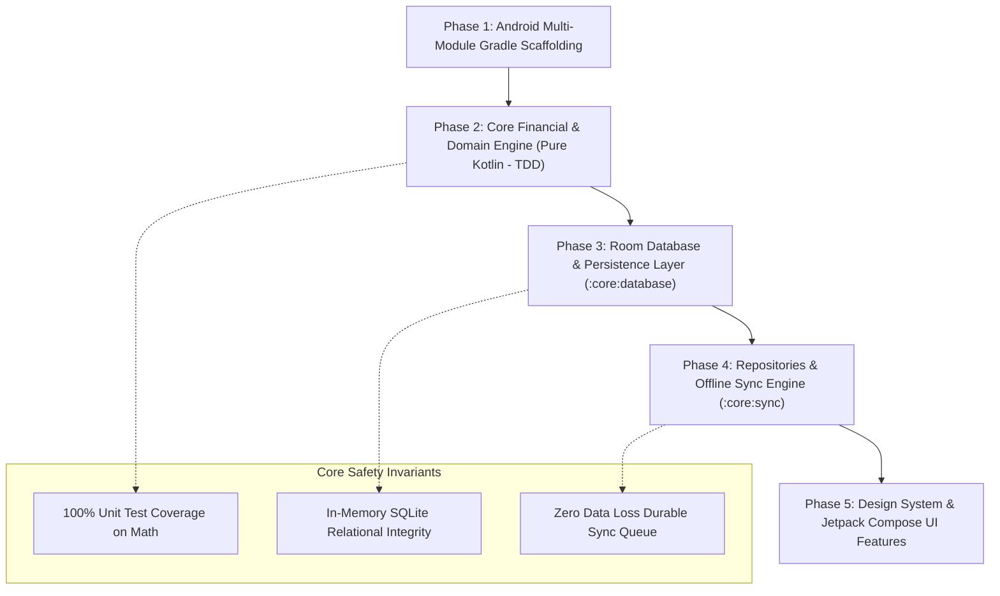

# SettleZero — Detailed Implementation Plan v0.1

**Product:** SettleZero  
**Tagline:** *Split bills, settle to zero. Keep the app free.*  
**Architecture:** Local-First Android (Kotlin, Jetpack Compose, Room, WorkManager, MVI/UDF)  
**Execution Strategy:** Inside-Out (Domain Math $\to$ Persistence $\to$ Sync $\to$ UI Features)

---

## Executive Summary & Engineering Strategy

SettleZero is an offline-first distributed expense ledger. In financial applications with offline sync, **the greatest architectural risk is domain and calculation drift** (floating-point rounding discrepancies, non-deterministic debt graphs, and sync race conditions). 

Attempting to build screens and UI mockups before establishing a mathematically proven domain engine and a rock-solid database schema inevitably leads to costly rewrites. 

Therefore, SettleZero will be developed using an **Inside-Out, Domain-Driven Design (DDD)** approach across five distinct, sequential phases:



---

## Phase 1: Android Multi-Module Gradle Scaffolding

### 1. What Are We Doing?
Setting up the `android/` directory as a production-grade multi-module Gradle project using Gradle Version Catalogs (`libs.versions.toml`), Kotlin 2.x, Android Gradle Plugin 8.7+, Java 17/21 target, and scaffolding the root project and foundational modules (`:app`, `:core:model`, `:core:domain`, `:core:common`).

### 2. Why Are We Doing That Specifically?
* **Build Performance & Cacheability:** Multi-module architecture enforces strict dependency boundaries. Pure modules like `:core:domain` and `:core:model` have zero Android framework dependencies, enabling sub-second compilation and test execution on the JVM.
* **Single Source of Truth for Dependencies:** A centralized Gradle Version Catalog (`libs.versions.toml`) prevents dependency drift and conflicting library versions across modules.
* **Tooling Isolation:** Placing the Gradle root directly inside `android/` allows developers to open `android/` directly in Android Studio without IDE indexing conflicts with non-Android files (backend, web, contracts).

### 3. How Are We Doing It?
1. Generate the standard Gradle Wrapper (`gradlew`, `gradlew.bat`, `gradle/wrapper/gradle-wrapper.jar`) with modern Gradle 8.10+.
2. Create `android/gradle/libs.versions.toml` defining versions, libraries, plugins, and dependency bundles:
   * AndroidX (Core KTX, Lifecycle, Activity Compose)
   * Jetpack Compose BOM & Material 3
   * Jetpack Room 2.6+ (Runtime, KTX, Compiler KSP)
   * Jetpack WorkManager 2.10+
   * Hilt / Kotlinx Coroutines & Serialization
   * Testing (JUnit 5 / JUnit 4, Kotlin Coroutines Test, Truth / AssertJ)
3. Create root build configurations:
   * `android/settings.gradle.kts`: Configures dependency resolution and module inclusions.
   * `android/build.gradle.kts`: Root script applying plugins with `apply false`.
4. Scaffold the foundational module build scripts:
   * `:core:model`: Pure Kotlin library module (`plugins { id("kotlin") }`).
   * `:core:common`: Pure Kotlin/Android library module.
   * `:core:domain`: Pure Kotlin module depending on `:core:model` and `:core:common`.
   * `:app`: Android application module with manifest and basic application class.

### 4. Sequence & Deliverables
* **Sequence:** Wrapper setup $\to$ Version Catalog $\to$ Root build scripts $\to$ Module build scripts $\to$ Gradle sync verification.
* **Deliverables:**
  - `android/gradle/libs.versions.toml`
  - `android/settings.gradle.kts`
  - `android/build.gradle.kts`
  - `android/core/model/build.gradle.kts`
  - `android/core/domain/build.gradle.kts`
  - `android/core/common/build.gradle.kts`
  - `android/app/build.gradle.kts` & `AndroidManifest.xml`
* **Verification Criteria:**
  - `./gradlew tasks` executes without errors.
  - Project opens cleanly in Android Studio Ladybug/Meerkat with zero sync failures.

---

## Phase 2: Core Financial & Domain Engine (Pure Kotlin — TDD)

### 1. What Are We Doing?
Implementing the core business logic, financial models, validation rules, and algorithms in `:core:domain` and `:core:model` using Test-Driven Development (TDD).

### 2. Why Are We Doing That Specifically?
* **Zero Tolerance for Financial Errors:** SettleZero's core promise is: *"Record what happened. Calculate who owes whom. Settle up."* A rounding error of even 1 paisa / 1 cent destroys user trust.
* **Deterministic Multi-Device Consensus:** In a distributed ledger without centralized servers resolving balances on the fly, every device must calculate the exact same split and simplification graph down to the last minor unit.
* **Blazing Fast TDD Feedback Loop:** Because `:core:domain` is pure Kotlin, unit test suites run in less than 200ms on the JVM without needing Android emulators or Robolectric.

### 3. How Are We Doing It?
We will implement and test five primary domain components:

#### A. Multi-Currency Minor-Unit Value Engine (`CurrencyAmount`)
* Value class wrapping `Long` minor units (e.g. 10000 paise = ₹100.00).
* Integrates ISO-4217 standard currency scales (0 decimals for JPY, 2 for INR/USD, 3 for KWD).
* Arithmetic operators (`+`, `-`, `*`, `/`) with overflow safety and string formatting.
* Strict prohibition of `Float` and `Double`.

#### B. Equal Split Allocator (`EqualSplitAllocator`)
* Divides total minor units $A$ among $N$ participants:
  $$\text{base} = \lfloor A / N \rfloor, \quad R = A \pmod N$$
* Distributes remainder minor units $R$ to the first $R$ participants when sorted **lexicographically by immutable `Member ID` string**.
* Invariant: $\sum \text{Allocated} = A$.

#### C. Net Balance Derivation Engine (`NetBalanceProjector`)
* Pure function: `calculateNetBalances(members, expenses, settlements): Map<MemberId, Long>`.
* Invariant: Sum of all net balances across the group strictly equals zero ($\sum \text{Net} = 0$).
* Excludes soft-deleted expenses and soft-deleted settlements.

#### D. Deterministic Debt Simplification Engine (`DebtSimplifier`)
* Solves the minimum cash flow bipartite problem using a greedy matching algorithm.
* **Tie-Breaking Rule:** Debtors sorted ascending by balance (ties broken by `Member ID` ascending); Creditors sorted descending by balance (ties broken by `Member ID` ascending).
* Guarantees that every device produces the identical recommended repayment graph.

#### E. Transaction Validation Rules (`TransactionValidator`)
* Validates expense amount $> 0$ and at least one participant.
* Enforces that claimed or unclaimed active members can be non-participating payers.
* Strictly rejects settlements that exceed current outstanding debt between two members.
* Enforces that archived members cannot participate in new expenses, but can settle existing debts.

### 4. Sequence & Deliverables
* **Sequence:** Domain models $\to$ Currency arithmetic $\to$ Unit tests $\to$ Equal split allocation $\to$ Unit tests $\to$ Net balance projection $\to$ Unit tests $\to$ Debt simplification algorithm $\to$ Unit tests.
* **Deliverables:**
  - `core/model/src/main/kotlin/app/settlezero/core/model/` (Value classes, Domain Enums, Models)
  - `core/domain/src/main/kotlin/app/settlezero/core/domain/` (Calculation engines and validators)
  - `core/domain/src/test/kotlin/app/settlezero/core/domain/` (30+ comprehensive unit tests)
* **Verification Criteria:**
  - 100% test pass on edge cases: ₹100 split 3 ways (33.34, 33.33, 33.33), cyclic debts ($A \to B \to C \to A$), overpayment rejection, zero-balance groups.
  - Test suite passes in `< 1 second` on pure JVM via `./gradlew :core:domain:test`.

---

## Phase 3: Room Database & Persistence Layer (`:core:database`)

### 1. What Are We Doing?
Designing and implementing the local SQLite relational persistence layer using Android Jetpack Room, defining entities, DAOs, relationships, foreign keys, and reactive queries.

### 2. Why Are We Doing That Specifically?
* **Local-First Working State:** The database is the authoritative local state. UI observes reactive Room `Flow`s; whenever a transaction is inserted or deleted, UI balances update immediately on disk without network latency.
* **Relational Integrity:** Foreign keys with `ON DELETE CASCADE` ensure data consistency between groups, members, and transactions.
* **Immutable Append-Only Audit Trail:** Soft-deletion columns (`is_deleted`, `deleted_at`, `deleted_by_member_id`) ensure historical events are never destroyed without an audit record.

### 3. How Are We Doing It?
1. Create `:core:database` module build script with Room KSP dependencies.
2. Implement Room Entities:
   * `GroupEntity`: Group metadata, currency scale, lock flag, invite token, read-only flag.
   * `MemberEntity`: Member name, role enum, status enum, group foreign key.
   * `ExpenseEntity`: Description, amount minor units, payer ID, creator ID, expense date, soft-delete flags.
   * `ExpenseSplitEntity`: Junction table linking expenses to participant allocations.
   * `SettlementEntity`: Payer ID, recipient ID, amount minor units, soft-delete flags.
   * `ActivityHistoryEntity`: Chronological log of group events and actor IDs.
   * `SyncQueueEntity`: Pending offline operations queue with idempotency keys.
3. Implement Room DAOs:
   * `GroupDao`: Reactive queries for active and archived groups.
   * `MemberDao`: Reactive member listings sorted by status and name.
   * `ExpenseDao`: Transaction queries with split allocations via Room `@Transaction` relation models.
   * `SettlementDao`: Settlement queries, soft-delete updates, restoration updates.
   * `SyncQueueDao`: Atomic queue management (enqueue, fetch pending, mark synced/rejected).
4. Implement TypeConverters:
   * String/UUID converters, Epoch millisecond converters, and Enum string converters.
5. In-Memory Testing:
   * Create an automated Room test harness verifying transactional writes, cascading deletes, and complex queries.

### 4. Sequence & Deliverables
* **Sequence:** Module setup $\to$ Entities & Converters $\to$ DAOs $\to$ Database Class $\to$ In-memory DAO unit tests.
* **Deliverables:**
  - `android/core/database/build.gradle.kts`
  - Entity classes (`GroupEntity.kt`, `ExpenseEntity.kt`, etc.)
  - DAO interfaces (`GroupDao.kt`, `ExpenseDao.kt`, etc.)
  - `SettleZeroDatabase.kt` & `Converters.kt`
  - Comprehensive Room in-memory test suite
* **Verification Criteria:**
  - All database unit tests pass on an in-memory SQLite database.
  - Foreign key constraints properly cascade and enforce referential integrity.

---

## Phase 4: Repositories & Offline Sync Engine (`:core:sync` & Data Layer)

### 1. What Are We Doing?
Connecting the domain calculation engine and the Room database through repository interfaces, and implementing durable offline synchronization using Android Jetpack WorkManager.

### 2. Why Are We Doing That Specifically?
* **Atomicity of Local Write + Sync Enqueue:** A user action (e.g. adding an expense) must write to the local database and enqueue an operation into `sync_queue` within a single atomic database transaction.
* **Resilience to Android Process Death:** WorkManager guarantees that offline operations survive app termination, device reboots, and Doze mode, executing automatically with exponential backoff when connectivity returns.
* **Clean Architecture Separation:** Feature ViewModels interact exclusively with Repository interfaces, remaining completely decoupled from Room DAOs or HTTP clients.

### 3. How Are We Doing It?
1. Implement Repository Layer:
   * `GroupRepository`: Handles group creation, member management, and invite generation.
   * `ExpenseRepository`: Handles expense creation, equal/unequal allocation generation, soft-deletion, and restoration.
   * `SettlementRepository`: Validates debt balances, records settlements, and handles deletions.
2. Implement Atomic Queue Insertion:
   * Every repository write wraps local entity insertion + `SyncQueueEntity` generation inside `database.withTransaction { ... }`.
3. Implement `SyncManager` & `SyncWorker`:
   * `SyncManager`: Handles real-time foreground sync when the app is active and online.
   * `SyncWorker`: WorkManager `CoroutineWorker` triggered on `NetworkType.CONNECTED` constraints to drain `sync_queue`.
4. Implement Conflict & Rejection Handlers:
   * Translates server rejection codes (`GROUP_ARCHIVED`, `PERMISSION_CHANGED`) into user-facing `SyncIssue` states.

### 4. Sequence & Deliverables
* **Sequence:** Repository interfaces $\to$ Offline-first implementations $\to$ WorkManager SyncWorker $\to$ SyncManager orchestrator $\to$ Repository integration tests.
* **Deliverables:**
  - `android/core/data/` (Repository contracts and implementations)
  - `android/core/sync/` (`SyncWorker.kt`, `SyncManager.kt`, Network monitors)
  - Unit & Integration tests mocking network sync responses
* **Verification Criteria:**
  - Offline expense creation commits locally and enqueues operation with idempotency key.
  - WorkManager schedules and executes synchronization upon simulated network reconnect.

---

## Phase 5: Design System & Jetpack Compose UI Features

### 1. What Are We Doing?
Building the complete user interface using Jetpack Compose, Material 3, and MVI ViewModels across all six user journeys.

### 2. Why Are We Doing That Specifically?
* **Instant, Reactive UI:** Compose observes Room `StateFlow` streams directly. When local transactions change, UI balances and lists update instantly without progress bars.
* **Design Consistency & Personality:** A dedicated `:core:ui` module standardizes typography, colors, and reusable widgets, ensuring the "minimal with subtle sarcasm" tone is applied consistently.
* **Predictable State Management:** MVI (Model-View-Intent) with immutable `UiState` and unidirectional events ensures the UI cannot enter undefined or corrupted visual states.

### 3. How Are We Doing It?
We will execute Phase 5 in five vertical feature slices:

```text
Phase 5 Execution Sequence:
5.1 Design System (:core:ui)
       ↓
5.2 Dashboard & Group Hub (:feature:dashboard, :feature:group)
       ↓
5.3 Expense Entry & Splitting (:feature:expense)
       ↓
5.4 Settle Up & Payments (:feature:settlement)
       ↓
5.5 Identity Claim & Verification (:feature:claim)
       ↓
5.6 Audit History & Settings (:feature:history, :feature:settings)
```

#### Step 5.1: Design Tokens & Reusable UI (`:core:ui`)
* Material 3 Theme with Dynamic Color support and dark mode.
* Reusable components:
  * `CurrencyTextField`: Dynamic minor-unit keypad formatter.
  * `StatusBadge`: Visual indicators for `Active`, `Unclaimed`, and `Archived`.
  * `MemberAvatar`: Clean initials-based avatar with role icons (👑 Super Admin, 🛡️ Admin).
  * `BalanceCard`: Natural language balance summary (*"You are owed ₹1,250"*).

#### Step 5.2: Dashboard & Group Hub (`:feature:dashboard`, :feature:group`)
* Journey 1 compliance: Empty state, group creation modal, currency selector.
* Group overview: Personal balance first, group member balances, quick-action FABs.

#### Step 5.3: Expense Creation & Splitting (`:feature:expense`)
* Journey 3 compliance: Single-screen expense entry, date picker, multiline note.
* Split modes: Equal split (default) with participant toggles; Unequal split with real-time balance validation (*"Remaining: ₹50"*).

#### Step 5.4: Settle Up Flow (`:feature:settlement`)
* Journey 4 compliance: Automatic proposed repayment derivation, partial payment entry, confirmation sheet, and strict overpayment prevention.

#### Step 5.5: Join Flow & SAS Claim Verification (`:feature:claim`)
* Journey 2 compliance: Invite link preview (privacy-preserving, hiding member names).
* Join decision: New member vs Existing member claim.
* 4-digit Short Authentication String (SAS) code display and Admin approval dialog.

#### Step 5.6: Activity History & Data Portability (`:feature:history`, `:feature:settings`)
* Chronological audit log with filter chips (Expenses, Settlements, Members).
* JSON export and read-only import viewer with group cloning.

### 4. Sequence & Deliverables
* **Sequence:** Design system $\to$ Group screens $\to$ Expense entry $\to$ Settle Up $\to$ Join/Claim $\to$ Navigation wiring in `:app`.
* **Deliverables:**
  - `:core:ui` design tokens and components
  - `:feature:*` modules with Compose screens, ViewModels, and UI state models
  - Complete navigation graph in `:app`
* **Verification Criteria:**
  - Complete user flow runs end-to-end on Android device / emulator.
  - All screens render correctly in both light and dark themes.

---

## Complete Implementation Schedule & Milestones

| Milestone | Target Scope | Key Verification Checkpoint |
|---|---|---|
| **M1: Scaffolding** | Phase 1 | Gradle builds cleanly; project opens in Android Studio. |
| **M2: Domain Math** | Phase 2 | 100% unit test pass on Currency, Splits, and Simplification. |
| **M3: Persistence** | Phase 3 | Room entities, DAOs, and in-memory relational tests pass. |
| **M4: Data & Sync** | Phase 4 | Repositories commit locally and enqueue offline WorkManager tasks. |
| **M5: UI & App** | Phase 5 | Full end-to-end user flows working natively in Jetpack Compose. |

